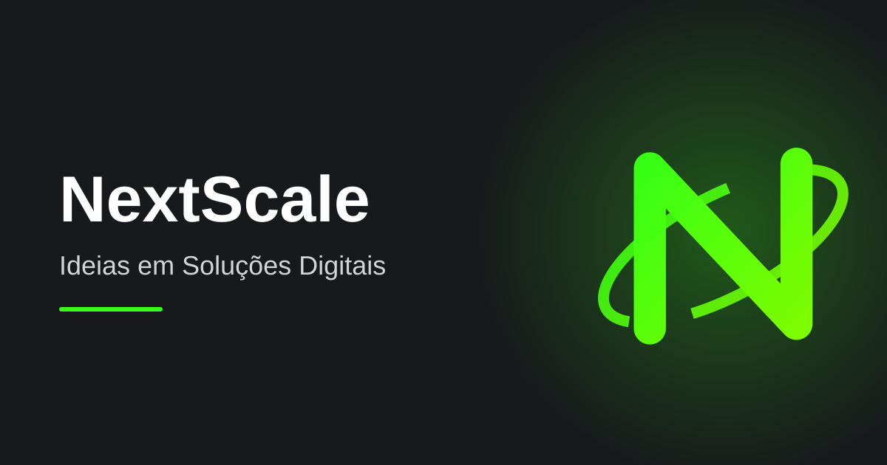

<div align="center">



<a href="https://nextscale.com.br">
  
</a>

<br>

[](https://nextscale.com.br)
[](https://wa.me/5500000000000?text=Ol%C3%A1!%20Vim%20pelo%20Site%20Oficial%20da%20NextScale.)
[](https://instagram.com/nextscale)
[](mailto:contato@nextscale.com.br)

**[Apresentação](#-apresentação)** · **[Seções](#-seções-da-página)** · **[Diferenciais](#-diferenciais-técnicos)** · **[Como Visualizar](#-como-visualizar)** · **[Contato](#-solicite-um-orçamento)**

</div>

<br>

## 🟢 Apresentação

O **SiteOficialNS** é a vitrine institucional e oficial da **NextScale**. Projetado para conectar nossa marca a clientes e parceiros, ele apresenta nosso ecossistema de soluções digitais com foco em credibilidade, estética refinada e alta conversão.

<div align="center">


</div>

<br>

## 🚀 Seções da Página

Cada detalhe da nossa página foi desenhado estrategicamente para apresentar nossos serviços e guiar o cliente até a contratação. **Clique nas seções para ver mais.**

<details>
<summary><b>⚡ &nbsp;Hero & Proposta de Valor</b></summary>
<br>

Abertura marcante com a promessa principal da marca: transformar ideias em soluções digitais que escalam o negócio do cliente.

> Acesso rápido direto para solicitação de orçamento e navegação fluida.

</details>

<details>
<summary><b>🛠️ &nbsp;Vitrine de Soluções</b></summary>
<br>

Exibição detalhada dos nossos pilares de atuação:
- **Criação de Sistemas:** Automação, dashboards e ferramentas sob medida.
- **Sites & Landing Pages:** Vitrines de alta performance e visual impecável.
- **Tráfego Pago:** Estratégia de atração de público qualificado.
- **Integrações & APIs:** Conexão de serviços e automações corporativas.

</details>

<details>
<summary><b>🛡️ &nbsp;Sobre Nós & Metodologia</b></summary>
<br>

Apresentação dos princípios da NextScale: inovação, tecnologia de ponta, foco no resultado do cliente e segurança em cada linha de código.

</details>

<details>
<summary><b>📁 &nbsp;Projetos & Portfólio</b></summary>
<br>

Galeria interativa com trabalhos e soluções desenvolvidas pela nossa equipe para demonstrar na prática nossa qualidade.

</details>

<details>
<summary><b>📬 &nbsp;Formulário de Captação & Orçamento</b></summary>
<br>

Canal direto de conversão com validação inteligente de campos para os clientes enviarem suas demandas com facilidade.

</details>

<br>

## ⚡ Diferenciais Técnicos

| | Diferencial | O que significa |
|:-:|:--|:--|
| 🚀 | **Zero Framework Bloat** | Desenvolvido com HTML5 e JS nativo para carregamento ultra rápido e nota máxima em Core Web Vitals. |
| 🎨 | **CSS Modular & Design System** | Estilos organizados em módulos reutilizáveis mantendo fidelidade total à identidade visual da NextScale. |
| 📱 | **Responsividade Absoluta** | Experiência fluida garantida de telas ultra-wide até os menores smartphones. |
| 🔍 | **SEO & Social Share** | Tags Open Graph prontas para exibição elegante ao compartilhar o link no WhatsApp, LinkedIn e Instagram. |

<br>

## 💻 Como Visualizar

<details>
<summary><b>Opções de Execução Local</b></summary>
<br>

**1. Direto no Navegador:**
Abra o arquivo `index.html` em qualquer navegador.

**2. Servidor Local (Recomendado):**
```bash
# Com npm instalado:
npm start

# Ou com npx:
npx serve .
```

</details>

<br>

## 💬 Solicite um Orçamento

Quer dar o próximo passo e construir uma solução de alto nível para sua empresa?

<div align="center">

<br>

[](https://wa.me/5500000000000?text=Ol%C3%A1!%20Vim%20pelo%20Site%20Oficial%20da%20NextScale.)

<br>

<sub>© 2026 NextScale. Todos os direitos reservados.</sub>

</div>
